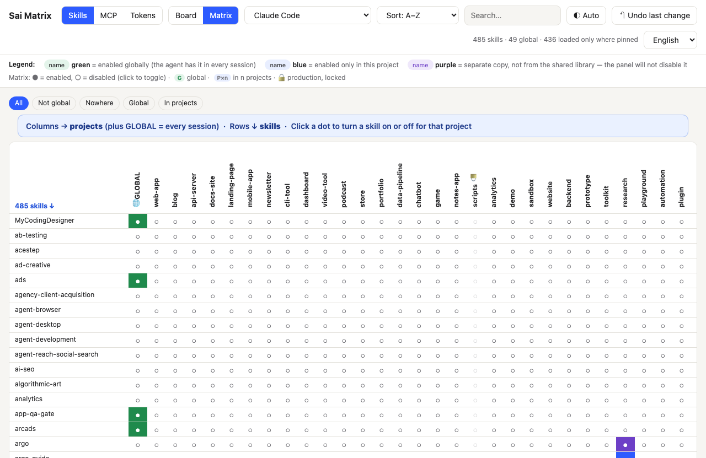
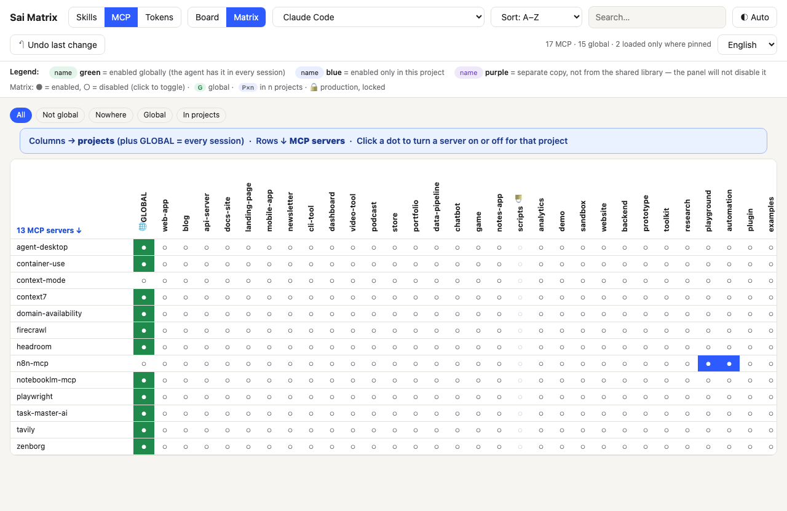
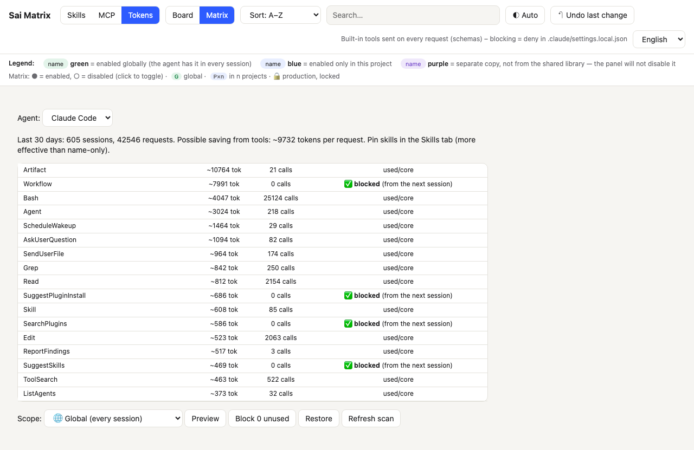

# Sai Matrix

**A local control panel for the skills and MCP servers your AI coding agents load, so each session only carries what it needs.**

Every skill you install and every MCP server you configure costs tokens on every request. Sai Matrix keeps your whole skill library in one place and lets you decide, per agent and per project, what is actually loaded. It also reports which built-in tools your agent sends on every request but never calls, and lets you switch them off.

Pure Python standard library. No dependencies, no build step, no telemetry. Everything runs on `127.0.0.1`.



Columns are projects, rows are skills. A dot is a skill loaded in that project; click it to turn the skill on or off. The same matrix exists for MCP servers:



The Tokens tab shows which built-in tools your agent loads but never uses:



Supports Claude Code, Codex, Gemini CLI, OpenCode, Hermes and Antigravity (skills for all of them; MCP editing for Claude Code and Gemini CLI, read-only view for the rest).

## Requirements

- macOS or Linux (**macOS is the tested platform**; Windows is not supported, see below)
- Python 3.11+
- Claude Code CLI (`claude`) in your `PATH`, if you want to manage Claude Code MCP servers

## Install and run

```bash
git clone <this repo>
cd sai-matrix
python3 server.py
```

Open <http://127.0.0.1:8765>. On macOS you can double-click `sai-matrix.command` instead.

## How it works

**Skills.** Your library lives in `~/.agents/skills`. Sai Matrix never moves or deletes anything there. Loading a skill means creating a symlink:

- *Global* = a symlink in the agent's skills directory (e.g. `~/.claude/skills`), loaded in every session.
- *Project* = a symlink in `<project>/.claude/skills` (or the agent's equivalent), loaded only in that project.

**skill-index.** Skills that are not pinned anywhere are listed in a generated `skill-index` skill. An agent can still discover them and read their `SKILL.md` on demand, so nothing becomes invisible, it just stops costing tokens until needed.

**MCP.** Server definitions are kept in `~/.claude/mcp-library.json` (mode `0600`). Global = `claude mcp add/remove -s user`; project = `<project>/.mcp.json`. MCP secrets are never sent to the browser.

**Undo.** Every pin/unpin is journaled in `.data/changes.jsonl`; the *Undo* button reverts the last change.

### Tokens tab

Reads what each agent sends on every request and what you actually used, then lets you switch off the dead weight. Always dry-run first; every write is reversible.

| Agent | What it does |
|---|---|
| Claude Code | Measures tool schemas and skill descriptions from your transcripts. Blocks unused built-in tools via `permissions.deny` (per project or global). |
| Hermes | Measures real tool schemas and your usage from `~/.hermes/state.db`. Disables unused toolsets with `hermes tools disable`. |
| Gemini CLI | Manual only: tick the tools you want in `tools.exclude` of `~/.gemini/settings.json`. Gemini keeps no usable per-tool usage history, so nothing is suggested. |
| Codex | Report only. Its logs expose tool namespaces, not individual tools, so no safe per-tool switch exists. |

Changes apply from the agent's next session. Settings files are backed up once before the first write.

## Configuration

Optional `config.json` next to `server.py` (see `config.example.json`):

```json
{
  "locked": ["~/work/my-production-checkout"],
  "hide_parts": ["/scratch/"]
}
```

- `locked`: projects Sai Matrix may read but never write to. Use it to protect production checkouts.
- `hide_parts`: path fragments; projects whose path contains one are hidden from the list.

The UI language (English, Polski, Español) is chosen with the selector in the top-right corner; English is the default.

## Security

- Binds to `127.0.0.1` only; requests with a foreign `Host` header are rejected, and all writes need a custom header.
- MCP secrets stay on disk (`0600`) and never reach the browser.
- Pinning an MCP server that has `env`/`headers` into a project writes it to `<project>/.mcp.json` (created `0600`). If git tracks that file, Sai Matrix refuses; otherwise it adds `.mcp.json` to the repo's local `.git/info/exclude`. For secrets, prefer pinning globally.
- The record of what the Tokens tab blocked is stored in `.data/`, never inside a project.
- No network calls, no analytics.
- Local state (`.data/`, `config.json`) is git-ignored.

## Support

None. Sai Matrix is provided as is, with no support and no guarantees. You are welcome to fork it and change it to fit your setup.

## Windows

Not supported. A port needs symlink support (administrator or Developer Mode), a different launcher, and removal of macOS-specific paths. There is no plan or date for it.

## About

Built by Saibertin, who builds AI agent systems. I made this for my own setup and I am sharing it as is. If it saved you time, say hi: <https://www.zenborg.com>.

Sai Matrix is an independent project. It grew out of the same tooling needs as [Zenborg](https://www.zenborg.com), a local-first desktop app that connects Claude Code, Codex, Gemini, OpenCode and Hermes into coordinated multi-agent loops (currently a free public beta). You do not need Zenborg to use Sai Matrix.

## License

[MIT](LICENSE) © 2026 Sai Matrix contributors
